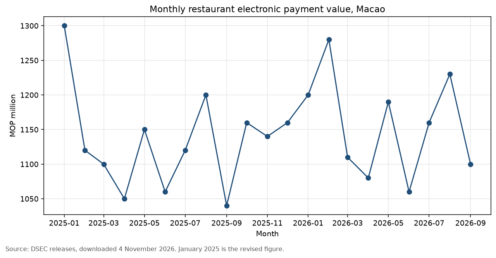
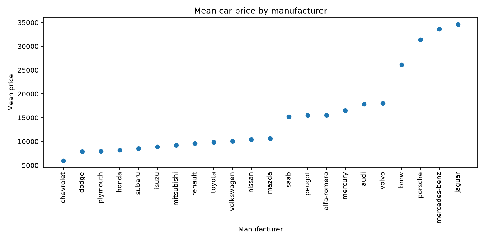

# CHAN CHENG I

MC649355 · CISC7204-001-D · University of Macau

## About me

I am a CISC7204 student. I use Python to clean public tables, check that the numbers can be traced, and show the result in charts.

## Technical skills

- Python, pandas, and matplotlib
- Cleaning and merging monthly official tables
- Correlation and simple regression
- GitHub and project documentation

## Featured project: Restaurant payments and visitors in Macao

### Research question

Between January 2025 and September 2026, how were monthly overnight and same-day visitor arrivals associated with restaurant electronic payment value in Macao?

### Approach

I used the monthly payment amounts stated in DSEC releases and the visitor counts for the same months. Python, pandas, and matplotlib produced the charts. A two-predictor regression was used only as an exploratory check.

### Visualization

### Findings

Same-day arrivals move a little more closely with restaurant payments than overnight arrivals do. In September 2026 the payment value was MOP1.10 billion, with 1,933,257 same-day visitors and 1,283,278 overnight visitors.

### Limitation

The series has 21 months, about one seasonal cycle. The two visitor groups rise and fall together, so a separate overnight effect is not stable. These figures describe this sample. They do not show cause. The vertical axis is MOP million. January 2025 is the revised DSEC figure of MOP1.30 billion, not the first published estimate.

## Revision after review

Team review, 4 November 2026: the payment chart did not say, in the text, what the measurement was, or that January 2025 had been revised.

Improvement: the caption and the project README now state MOP million, the revised January figure, and that the result is an association in this 21-month sample.

### Project repository

[View the code and README](https://github.com/CHANCHENGI/data-science-project)

### Status

Ongoing. The proposal and these charts are done. The final report is not.

## Earlier project: Mean car prices

**Research question.** Which manufacturers have the highest mean prices in the UCI automobiles sample?

**Finding.** Jaguar, Mercedes-Benz, and Porsche sit at the high end. Mass-market makes such as Chevrolet sit much lower.

**Limitation.** The UCI sample is small and older, so the ranking is not today's car market.

**Status.** Completed
